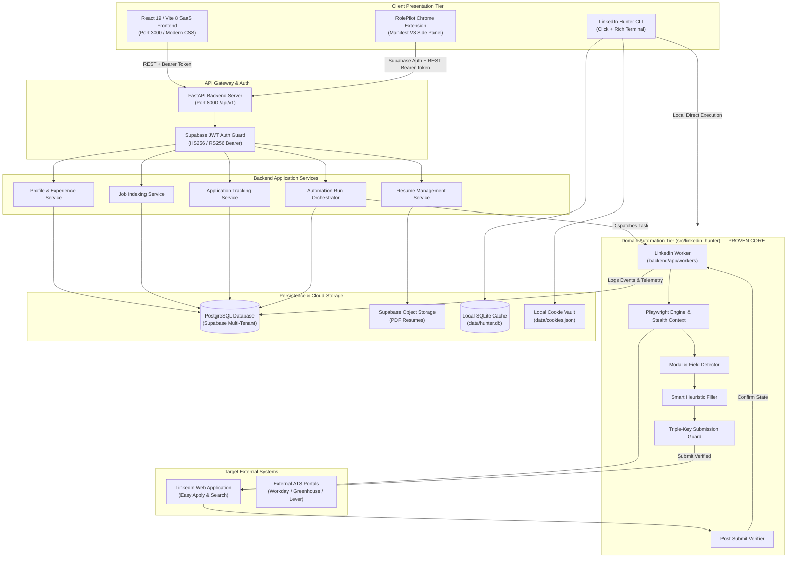
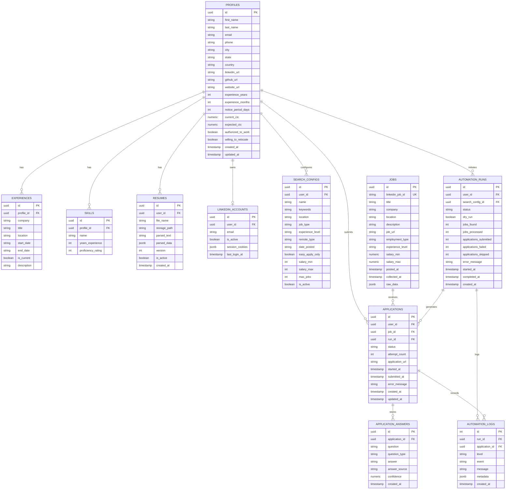
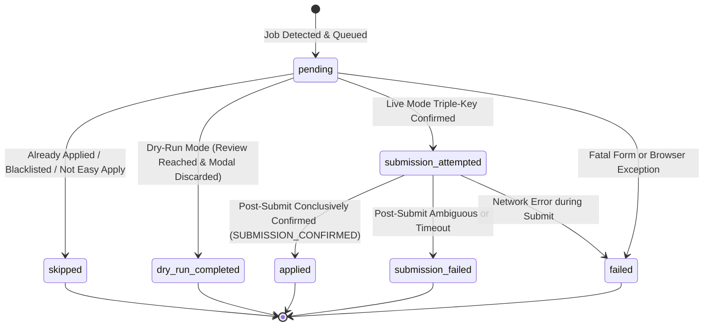
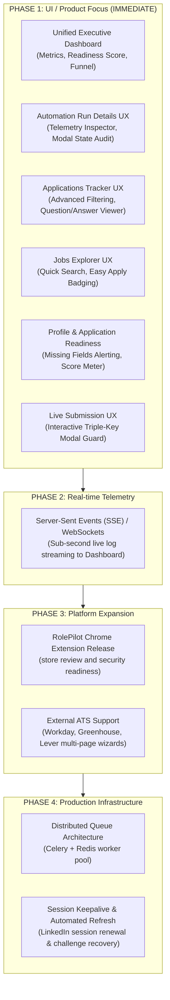

# LinkedIn Hunter V2 — System Architecture & Design Specification

> **Document Version:** 2.1.0  
> **Status:** Living Architecture Document (Validated Core Automation & Product Focus)  
> **Target System:** LinkedIn Hunter V2 (SaaS + CLI + Extension Suite)  
> **Repository:** `thejanmejay/linkedin-hunter-v2` (`/Users/janamjay/linkedin`)

---

## 1. Executive Summary & Core Tenets

**LinkedIn Hunter V2** is an enterprise-grade, multi-tenant job hunting automation, indexing, and application management ecosystem. It combines a high-speed CLI automation engine, a resilient modern SaaS backend API, a real-time React dashboard, and a companion Chrome extension into a unified platform.

### Core Architectural Tenets
1. **Humanized Anti-Detection First:** Automated browser sessions simulate realistic human latency, non-linear cursor movements (Bézier curves), natural typing jitter, and browser fingerprint masking to evade bot detection algorithms.
2. **Fail-Safe Triple-Key Guardrail:** Safety is paramount. Application submissions default to non-submitting dry runs (`dry_run=True`). Real submission requires three independent matching confirmation keys, strictly capped at single-job execution during live mode.
3. **Existing Automation Core:** The LinkedIn automation engine uses the existing session-ID workflow, with dry-run behavior and a server-side Triple-Key gate for live submissions.
4. **Strict Multi-Tenant Isolation:** All database transactions and file assets are strictly scoped to authenticated user UUIDs verified against cryptographically signed JWTs.
5. **Transparent Telemetry & Auditability:** Every action—modal transition, field classification, value matched, or safety block—is recorded as structured event logs accessible in real time via the SaaS dashboard.
6. **Adaptive Hybrid Heuristics:** Form filling relies on exact normalized matching, numeric range extraction, positional fallbacks, resume NLP extraction, and human-in-the-loop fallback prompts.

---

## 2. High-Level System Architecture

The following diagram illustrates the interaction between the client interfaces, API gateway, domain automation engine, persistence layers, and external platforms.



---

## 3. Existing Folder Structure Mapping

The workspace is organized into modular packages separating the standalone automation engine, SaaS API, React web client, companion browser extension, and test infrastructure.

```
/Users/janamjay/linkedin/
├── .env.example                 # Template for database URLs, Supabase credentials, and CORS
├── .gitignore                   # Ignores runtime data, secrets, build artifacts, venvs
├── config.yaml                  # Local profile, search, and answer heuristics for CLI
├── config.example.yaml          # Sample configuration template
├── pyproject.toml               # Python package metadata and CLI entry points (linkedin-hunter)
├── requirements.txt             # Consolidated dependencies (Playwright, FastAPI, SQLAlchemy, etc.)
├── README.md                    # Project overview, installation, and CLI documentation
├── SYSTEM_DESIGN.md             # Complete System Architecture & Design Specification (This Document)
│
├── src/linkedin_hunter/         # Core Domain Automation Engine (Layer 2 — PROVEN)
│   ├── __init__.py
│   ├── __main__.py              # Python module execution hook
│   ├── cli.py                   # Click CLI implementation (login, search, apply, status)
│   ├── config.py                # Pydantic domain models (ProfileConfig, SearchConfig, HunterConfig)
│   ├── auth/                    # Authentication & Session Resilience
│   │   ├── login.py             # Headed interactive browser login orchestrator
│   │   └── session.py           # Cookie serialization, session validation, checkpoint detection
│   ├── browser/                 # Browser Automation Infrastructure
│   │   ├── engine.py            # Playwright lifecycle, context isolation, proxy injection
│   │   ├── stealth.py           # Anti-detection evader (navigator.webdriver, plugins mask)
│   │   └── humanize.py          # Bézier mouse trajectories, keystroke micro-delays
│   ├── db/                      # Standalone CLI SQLite Storage
│   │   ├── models.py            # SQLite table definitions (jobs, applications, answers)
│   │   └── repository.py        # SQLite repository operations
│   ├── forms/                   # Easy Apply Modal Form Filling Intelligence
│   │   ├── detector.py          # Form field classification (Text, Select, Radio, Upload, etc.)
│   │   ├── filler.py            # Smart heuristic filler, option matcher, error recovery
│   │   ├── memory.py            # YAML/DB persistent memory for user-answered questions
│   │   ├── questions.py         # Regex routing (experience, notice period, salary, ratings)
│   │   ├── resume.py            # PDF resume parser (pdfplumber) and section extractor
│   │   └── user_prompt.py       # Rich interactive CLI prompt for unmapped questions
│   ├── jobs/                    # Job Collection & Apply Execution
│   │   ├── apply.py             # Multi-step Easy Apply engine with Triple-Key Safety Guard & Verification
│   │   ├── filters.py           # Title/company blacklisting and keyword inclusion filters
│   │   ├── parser.py            # DOM card parser for search results
│   │   └── search.py            # Virtualized scrolling search results collector
│   ├── tracker/                 # Application limits, daily caps, and rate accounting
│   │   └── tracker.py
│   ├── utils/                   # Shared Engine Utilities
│   │   ├── logging.py           # Structured formatting with Rich console integration
│   │   ├── rate_limiter.py      # Token bucket rate limiting with burst and rest intervals
│   │   ├── retry.py             # Exponential backoff and retry decorators
│   │   └── shutdown.py          # Graceful SIGINT/SIGTERM handling
│   └── workday/                 # External ATS Automation (Planned Expansion)
│       ├── apply.py             # Multi-page Workday job application workflow
│       ├── constants.py         # Workday DOM selectors and endpoint definitions
│       ├── detector.py          # Workday wizard step & form field detector
│       └── filler.py            # Workday auto-fill implementation
│
├── backend/                     # SaaS Multi-Tenant Backend (FastAPI + SQLAlchemy)
│   ├── app/
│   │   ├── __init__.py
│   │   ├── main.py              # FastAPI application, CORS, lifespan, global error handlers
│   │   ├── core/                # Core Configuration & Security
│   │   │   ├── config.py        # Pydantic Settings (Supabase URLs, Database connection)
│   │   │   └── security.py      # JWT Bearer validation, Supabase user extraction
│   │   ├── db/                  # Database Layer
│   │   │   ├── database.py      # SQLAlchemy 2.0 engine, SessionLocal, get_db dependency
│   │   │   └── models/          # Declarative SQLAlchemy ORM Models
│   │   │       ├── application.py          # Tracked job applications
│   │   │       ├── application_answer.py   # Cached answers given to questions
│   │   │       ├── automation_log.py       # Detailed event audit logs
│   │   │       ├── automation_run.py       # Automation execution records & counters
│   │   │       ├── experience.py           # Work history items
│   │   │       ├── job.py                  # Scraped and indexed job postings
│   │   │       ├── linkedin_account.py     # User LinkedIn session storage
│   │   │       ├── profile.py              # User candidate profiles
│   │   │       ├── resume.py               # Resume files and parsed metadata
│   │   │       ├── search_config.py        # Search criteria and filter settings
│   │   │       └── skill.py                # Skills and proficiency ratings
│   │   ├── schemas/             # Pydantic Request & Response DTOs
│   │   │   ├── application.py
│   │   │   ├── automation.py
│   │   │   ├── job.py
│   │   │   ├── profile.py
│   │   │   ├── resume.py
│   │   │   └── search.py
│   │   ├── services/            # Business Logic Layer
│   │   │   ├── application_service.py
│   │   │   ├── automation_service.py
│   │   │   ├── job_service.py
│   │   │   ├── profile_service.py
│   │   │   ├── resume_service.py
│   │   │   └── search_service.py
│   │   ├── api/                 # REST Route Handlers (/api/v1)
│   │   │   ├── router.py        # Combined v1 router
│   │   │   ├── applications.py
│   │   │   ├── automation.py
│   │   │   ├── jobs.py
│   │   │   ├── profile.py
│   │   │   ├── resumes.py
│   │   │   └── search.py
│   │   └── workers/             # Background Task Processing
│   │       └── linkedin_worker.py  # Bridges SaaS DB with Domain Engine via Playwright
│
├── frontend/                    # Modern SaaS React Dashboard (React 19 + Vite 8 + TS)
│   ├── index.html               # SPA Entry point
│   ├── vite.config.ts           # Vite 8 bundler configuration & backend API reverse proxy
│   ├── package.json             # React 19.2.8, Lucide React 1.48.0, Supabase JS 2.109.0, Oxlint
│   └── src/
│       ├── main.tsx             # React DOM root render
│       ├── App.tsx              # Tab router (Profile, Jobs, Applications, Automation)
│       ├── App.css / index.css  # Premium responsive design system (Glassmorphism, dark palette)
│       ├── api/                 # Strongly-typed HTTP Client
│       │   ├── client.ts        # Fetch wrapper with auto-auth headers & error parsing
│       │   ├── applications.ts
│       │   ├── automation.ts
│       │   ├── jobs.ts
│       │   └── profile.ts
│       ├── context/             # Global Context Providers
│       │   ├── AuthContext.tsx  # Supabase authentication and session token storage
│       │   └── ToastContext.tsx # User notification toasts
│       ├── types/               # TypeScript Interfaces
│       │   ├── automation.ts
│       │   ├── job.ts
│       │   └── profile.ts
│       ├── components/          # Modular UI Components
│       │   ├── Navbar.tsx
│       │   ├── AuthModal.tsx
│       │   ├── Modal.tsx
│       │   ├── Skeleton.tsx
│       │   ├── profile/         # BasicInfo, Experience, Skills, Education, Additional
│       │   ├── jobs/            # JobCard, JobFilters, JobDetailsPanel, SearchConfigModal
│       │   ├── applications/    # ApplicationCard, Table, Stats, Filters, StatusModal
│       │   └── automation/      # RunCard, Stats, LogsViewer, TriggerModal, QueueBreakdown
│       └── pages/               # Top-Level Page Views
│           ├── ApplicationsPage.tsx
│           ├── AutomationPage.tsx
│           ├── JobsPage.tsx
│           └── ProfilePage.tsx
│
├── chrome-extension/rolepilot/  # RolePilot Manifest V3 extension source
├── chrome-extension/rolepilot-build/ # Locally generated unpacked extension (ignored)
│
├── tests/                       # Pytest Test Automation & Quality Assurance Suite (57/57 Passing)
│   ├── test_backend.py          # FastAPI endpoint integration, JWT auth, tenant isolation (37 tests)
│   ├── test_fixes.py            # Question heuristics, notice period, rating scales, degrees (regression)
│   └── test_playwright_apply.py # Playwright browser automation, dry-run guard, Triple-Key safety (20 tests)
│
├── scripts/                     # Developer & Validation Utility Scripts
│   ├── get_test_token.py        # Generates test JWT tokens for local API testing
│   └── validate_single_run.py   # Runs isolated Playwright dry run against real LinkedIn job
│
├── data/                        # Local Storage (Excluded from Git)
│   ├── cookies.json             # Serialized LinkedIn session cookies
│   ├── hunter.db                # SQLite database for CLI operations
│   └── user_memory.yaml         # Learned answers for unseen questions
│
└── resumes/                     # Local resume PDF store
    └── resume.pdf
```

---

## 4. Database Schema & Entity Relationships

The PostgreSQL database (managed via Supabase and mapped using SQLAlchemy 2.0 ORM) enforces strict relational constraints and foreign-key cascading.



---

## 5. Proven Backend Automation & Safety Architecture

The core LinkedIn Easy Apply browser automation engine is now **fully validated and proven**. Real live runs have confirmed that the end-to-end execution path operates reliably in live browser conditions:

$$\text{Job} \longrightarrow \text{Easy Apply} \longrightarrow \text{Form Detection} \longrightarrow \text{Smart Fill} \longrightarrow \text{Review} \longrightarrow \text{Triple-Key Guard} \longrightarrow \text{Submit} \longrightarrow \text{Post-Submit Verification} \longrightarrow \text{DB}$$

### Application Lifecycle State Machine

Applications transition through explicit, audited lifecycle states:



#### Application State Definitions
- `pending`: Application detected in search results and queued for processing.
- `dry_run_completed`: All wizard steps were detected, filled, and reviewed. Final submission was deliberately and safely blocked by the safety guard; the modal was cleanly discarded with full telemetry saved.
- `applied`: Final submit button clicked, and post-submission state conclusively verified via LinkedIn confirmation modal/checkmark.
- `submission_failed`: Final submit button was clicked, but post-submission verification could not conclusively confirm completion within the timeout window. Application count is **not incremented**.
- `skipped`: Job skipped due to prior application, title/company blacklisting, or absence of an Easy Apply button.
- `failed`: Unrecoverable exception during field parsing or page navigation.

### The Fail-Safe Triple-Key Guardrail
Live application submission cannot occur accidentally. A submission call is only dispatched to LinkedIn if all three keys are simultaneously satisfied:

$$\text{Live Submission Authorized} \iff (\text{dry\_run} == \text{False}) \land (\text{allow\_live\_submission} == \text{True}) \land (\text{live\_submission\_confirmation} == \text{"CONFIRM\_REAL\_SUBMISSION"})$$

If any key is missing or false:
- The runner completes the entire workflow (modal navigation, input filling, resume attachment, review screen inspection).
- The final submit button click is strictly intercepted and blocked (`DRY_RUN_SUBMIT_BLOCKED`).
- The modal is discarded cleanly via the modal dismiss handler (`_dismiss_modal`).
- Telemetry records `review_reached: True`, `submission_blocked: True`, and `submission_confirmed: False`.
- In addition, live submission runs are hard-capped to a maximum of 1 job per execution to prevent runaway automated loops.

### Post-Submission Conclusive Verification
After clicking submit (`submit_final_application`), the worker calls `verify_post_submit_status(page)`:
1. Validates that the application modal has closed (`div.jobs-easy-apply-modal` no longer visible).
2. Looks for LinkedIn's post-submission confirmation toast/dialog (e.g. *"Application sent"*, *"Your application was sent to [Company]"*).
3. If confirmed, records `SUBMISSION_CONFIRMED` event and updates application status to `applied`.
4. If ambiguous or timed out, marks `submission_failed` and records full diagnostic metadata.

---

## 6. Form Field Detection & Heuristics Engine

The forms engine (`src/linkedin_hunter/forms/`) handles dynamic, unstandardized questions presented in LinkedIn Easy Apply forms using specialized heuristic rules:

| Category | Input / Question Pattern | Heuristic Resolution Logic | Fallback Behavior |
| :--- | :--- | :--- | :--- |
| **Notice Period** | *"Please enter your notice period in days"*, *"Days available to join"* | Extracts `profile.notice_period_days` (e.g. `30`). Never outputs `0` unless explicitly configured. | Default: `30` |
| **Immediate Joiner** | *"Are you available to join immediately?"* | Checks `notice_period_days`. If `> 0`, selects `No`. If `0`, selects `Yes`. | Consistent with notice period |
| **Skill Experience** | *"How many years of experience do you have with [Skill]?"* | Looks up Skill in `profile.skills`. If not listed, matches overall `profile.experience_years`. | Default: `1` |
| **Rating (1 to 5)** | *"Rate your [Skill/Language] skills out of 5"* | Clamps rating to maximum `5`. Never returns values $> 5$ (e.g. prevents default `7`). | Default: `5` |
| **Rating (1 to 10)** | *"Rate your skills on a scale of 1 to 10"* | Clamps rating to maximum `10`. | Default: `8` - `10` |
| **Degrees / Education** | *"Have you completed Bachelor's Degree?"* | Answers `Yes`. Never populates degrees with University names. | Default: `Yes` |
| **Numeric Dropdowns** | Dropdowns with options like `["0 month", "1 month", "10 months"]` | Exact label match $\to$ Number-in-label matching $\to$ Positional index fallback. | Option index `0` or `1` |
| **Work Authorization** | *"Are you legally authorized to work in [Country]?"* | Reads `profile.authorized_to_work` boolean $\to$ selects `Yes` / `No`. | Default: `Yes` |
| **Relocation** | *"Are you comfortable commuting or relocating?"* | Reads `profile.willing_to_relocate` boolean $\to$ selects `Yes` / `No`. | Default: `Yes` |
| **Compensation (CTC)** | *"What is your expected CTC / salary?"* | Injects `profile.expected_ctc` as integer string. | Profile CTC |
| **Profiles & Links** | *"GitHub Profile"*, *"Portfolio URL"* | Maps `profile.github_url` or `profile.website_url`. | Configured URL |

---

## 7. REST API Contract & Route Specifications

The backend exposes a standardized RESTful API under the `/api/v1` namespace. All non-public endpoints require `Authorization: Bearer <SUPABASE_JWT_TOKEN>`.

### Route Matrix
| Method | Endpoint | Description | Request Body | Response Model |
| :--- | :--- | :--- | :--- | :--- |
| `GET` | `/health` | Application health check | *None* | `{"status": "ok"}` |
| `GET` | `/health/db` | Database connection check | *None* | `{"status": "ok", "database": "connected"}` |
| `GET` | `/api/v1/profile` | Retrieve user profile | *None* | `ProfileResponse` |
| `PUT` | `/api/v1/profile` | Create or update profile | `ProfileUpdate` | `ProfileResponse` |
| `POST` | `/api/v1/profile/experiences` | Add experience record | `ExperienceCreate` | `ExperienceResponse` |
| `DELETE` | `/api/v1/profile/experiences/{id}` | Delete experience record | *None* | `204 No Content` |
| `POST` | `/api/v1/profile/skills` | Add skill record | `SkillCreate` | `SkillResponse` |
| `DELETE` | `/api/v1/profile/skills/{id}` | Delete skill record | *None* | `204 No Content` |
| `GET` | `/api/v1/resumes` | List uploaded resumes | *None* | `List[ResumeResponse]` |
| `POST` | `/api/v1/resumes/upload` | Upload PDF resume to storage | `multipart/form-data` | `ResumeResponse` |
| `PUT` | `/api/v1/resumes/{id}/activate` | Set active primary resume | *None* | `ResumeResponse` |
| `GET` | `/api/v1/search/configs` | List search configurations | *None* | `List[SearchConfigResponse]` |
| `POST` | `/api/v1/search/configs` | Create search configuration | `SearchConfigCreate` | `SearchConfigResponse` |
| `GET` | `/api/v1/jobs` | Browse collected jobs | Query filters | `List[JobResponse]` |
| `GET` | `/api/v1/applications` | List candidate applications | Query filters | `List[ApplicationResponse]` |
| `GET` | `/api/v1/applications/stats` | Application metrics & counts | *None* | `ApplicationStatsResponse` |
| `PATCH` | `/api/v1/applications/{id}/status` | Update application status | `{"status": "string"}` | `ApplicationResponse` |
| `POST` | `/api/v1/automation/runs` | Trigger background automation | `AutomationRunCreate` | `AutomationRunResponse` |
| `GET` | `/api/v1/automation/runs` | List recent automation runs | Pagination queries | `List[AutomationRunResponse]` |
| `GET` | `/api/v1/automation/runs/{id}` | Get run details & counters | *None* | `AutomationRunResponse` |
| `GET` | `/api/v1/automation/runs/{id}/logs` | Stream event logs for run | Pagination queries | `List[AutomationLogResponse]` |

### Automation API Behavior & Guardrails
- **Default Dry Run:** Invocations of `POST /api/v1/automation/runs` default to `dry_run=True`.
- **Live Submission Safety Cap:** If `dry_run=False` and `allow_live_submission=True`, the backend hard-caps `effective_max_jobs = 1`.
- **Validation Token Check:** Rejects requests missing the `CONFIRM_REAL_SUBMISSION` confirmation token when attempting live submissions.

---

## 8. Anti-Detection & Humanized Browsing Strategies

To protect user accounts from automated scraping and bot identification by LinkedIn's security algorithms, `linkedin_hunter` implements multi-layered humanization techniques:

1. **Fingerprint Masking (`playwright-stealth`):**
   - Strips `navigator.webdriver` flags.
   - Mimics hardware concurrency, device memory, and WebGL renderers.
   - Emulates authentic user plugins and language preferences (`en-US,en`).
2. **Keystroke Cadence Modeling:**
   - Replaces instantaneous `input.fill()` calls with humanized typing loops.
   - Introduces variable inter-character delays (50ms to 180ms) with occasional natural pauses.
3. **Bézier Trajectory Mouse Movement:**
   - Calculates cubic Bézier curves for cursor motion between elements instead of direct teleportation.
   - Adds micro-jitters and slight overshoot/correction paths.
4. **Natural Page Navigation & Dynamic Scrolling:**
   - Uses fractional, smooth wheel delta scrolls with random pause intervals to allow virtualized DOM nodes to mount naturally.
5. **Token Bucket Rate Limiting:**
   - Enforces configurable delays between applications (default 3–8 seconds).
   - Injects mandatory cooling-off breaks (e.g. 120-second rest after every 10 applications).

---

## 9. Implemented vs. Planned Architecture Matrix

| Architectural Capability | Current Status | Details & Implementation Location |
| :--- | :--- | :--- |
| **LinkedIn Easy Apply Flow** | ✅ **Implemented & Validated** | Proven end-to-end in `src/linkedin_hunter/jobs/apply.py` |
| **Triple-Key Safety Mechanism** | ✅ **Implemented & Validated** | Gated in `apply.py`, `linkedin_worker.py`, and API |
| **Post-Submission Verifier** | ✅ **Implemented & Validated** | Confirms modal closure & toast dialogs in `apply.py` |
| **Form Heuristics Engine** | ✅ **Implemented & Validated** | Notice period, ratings, education in `forms/filler.py` |
| **FastAPI SaaS Backend** | ✅ **Implemented & Validated** | 20+ REST endpoints in `backend/app/api/` |
| **Multi-Tenant JWT Auth** | ✅ **Implemented & Validated** | Supabase JWT Bearer in `backend/app/core/security.py` |
| **PostgreSQL / Supabase Schema** | ✅ **Implemented & Validated** | 11 ORM models in `backend/app/db/models/` |
| **Test Automation Suite** | ✅ **Implemented (57/57 Passed)** | `tests/test_backend.py`, `test_fixes.py`, `test_playwright_apply.py` |
| **Frontend Base Views** | ✅ **Implemented** | Profile, Jobs, Applications, Automation in `frontend/src/` |
| **RolePilot Chrome Extension** | ✅ **Implemented for local testing** | Authenticated side panel, profile/preferences, dry-run search, run history; live Apply to Jobs remains disabled |
| **Dedicated Executive Dashboard** | 🟡 **Next Immediate Priority** | High-level metrics, Application Readiness score, Pipeline Funnel |
| **Enhanced Run Details UX** | 🟡 **Next Immediate Priority** | Full-fidelity step inspector & telemetry breakdown |
| **Live Submission UX** | 🟡 **Next Immediate Priority** | Interactive modal confirmation with explicit token entry |
| **Server-Sent Events (SSE) Logs** | 🔵 *Planned (Phase 2)* | Real-time live log streaming replacing polling |
| **Chrome Extension Store Release** | 🔵 *Pending* | Local extension is not published; no Web Store listing is configured |
| **External ATS Automation** | 🔵 *Planned (Phase 3)* | Workday, Greenhouse, Lever multi-page wizard support |
| **Distributed Task Queue** | 🟣 *Planned (Phase 4)* | Celery / Redis background worker pool |
| **Automated Session Refresh** | 🟣 *Planned (Phase 4)* | Background session keepalive and cookie auto-refresh |

---

## 10. Implementation Phasing & Roadmap

The development strategy prioritizes the **SaaS frontend user experience** now that the core backend engine is proven and stable.



### Phase 1 Execution Sequence (Current Sprint):
$$\text{Responsive Dashboard} \longrightarrow \text{Run Details} \longrightarrow \text{Applications} \longrightarrow \text{Jobs} \longrightarrow \text{Profile} \longrightarrow \text{Automation Controls} \longrightarrow \text{Mobile/Tablet QA} \longrightarrow \text{UI Polish}$$

1. **Responsive Executive Dashboard (`DashboardPage.tsx`):**
   - Application Funnel (Found $\to$ Processed $\to$ Dry-Run $\to$ Applied).
   - Candidate Application Readiness meter (validates contact info, resume uploaded, notice period configured, target keywords set).
   - Quick-Action Runner (one-click dry run trigger with pre-filled defaults).
   - Active Run HUD & Recent Activity Feed with live status indicators.
2. **Automation Run Details UX:**
   - Dedicated run telemetry viewer showing steps completed, fields filled, questions resolved, and safety block indicators.
   - Mobile-friendly vertical telemetry timeline with step state cards.
   - Filterable event logs with severity highlighting (`INFO`, `WARNING`, `ERROR`).
3. **Applications Tracker UX:**
   - Adaptive table-to-card transformation for mobile screens.
   - Full-page inspection drawer displaying exact questions encountered and answers supplied.
4. **Jobs Explorer UX:**
   - Responsive filter drawer, search config modal, and Easy Apply badge highlights.
5. **Profile & Application Readiness:**
   - Readiness score calculation, missing fields checklist, inline editing.
6. **Automation Controls & Live Submission Guard:**
   - Mobile-friendly modal with warning callout and manual `CONFIRM_REAL_SUBMISSION` verification field.
7. **Mobile/Tablet QA & Visual Polish:**
   - Breakpoint audit across 320px, 375px/390px, 768px, 1024px, 1440px+.

---

## 11. Responsive & Multi-Device UX Architecture & Acceptance Criteria

Responsive design is a **first-class architectural requirement** for LinkedIn Hunter V2, ensuring a unified, seamless user experience from smartphones to ultra-wide desktop monitors without maintaining separate codebases.

### 11.1 Viewport Breakpoint Hierarchy
The design system enforces standard CSS breakpoint tokens using modern fluid layout techniques:

| Breakpoint Tier | Viewport Range | Device Examples | Navigation & Layout Strategy |
| :--- | :--- | :--- | :--- |
| **Mobile Compact** | `320px – 374px` | iPhone SE, Galaxy Mini | Single-column stack, compact bottom/drawer navigation, touch-optimized cards, 12px screen padding. |
| **Mobile Standard** | `375px – 767px` | iPhone 14/15/16, Pixel 8, Galaxy S24 | Single-column cards, bottom navigation bar, full-screen/bottom-sheet modals, touch targets $\ge 44\text{px}$. |
| **Tablet** | `768px – 1023px` | iPad (Portrait/Landscape), Surface | Adaptive 2-column grid, compact header nav, collapsible secondary drawers. |
| **Desktop / Laptop** | `1024px – 1439px` | MacBook Pro, Standard Laptops | Full top navbar, 3-to-4 column stat cards, side-by-side split inspectors, detailed tables. |
| **Wide Desktop** | `1440px+` | 27" iMac, Ultrawide Monitors | Centered constrained max-width (`1200px` – `1360px`), expanded telemetry logs, multi-pane views. |

### 11.2 Core Responsive Architectural Rules
1. **Single Adaptive Codebase:** Built entirely within one React 19 application using fluid CSS (`clamp()`, `minmax()`, CSS Grid, Flexbox) and scoped media queries. No separate mobile domains or parallel trees.
2. **Zero Horizontal Page Overflow:** The `body`, `.app-container`, and `.main-content` enforce `overflow-x: hidden` and strict `box-sizing: border-box`. All tables and pre-formatted log viewer containers must specify explicit internal horizontal scrolling (`overflow-x: auto`) rather than breaking the outer viewport.
3. **Table-to-Card Transformation on Mobile:**
   - On viewports $\le 768\text{px}$, wide tabular layouts (Applications Table, Jobs Table) must **transform into stacked, readable card components** with clear key-value metadata badges instead of shrinking table cells into unreadable truncated strings.
4. **Touch Target Sizing & Ergonomics:**
   - Interactive elements (buttons, filter chips, dropdowns, modal triggers, pagination links) must satisfy a minimum touch target bounding box of **$44\text{px} \times 44\text{px}$** with at least $8\text{px}$ spacing between adjacent tappable targets.
5. **Modal Adaptivity on Small Screens:**
   - Modals (Trigger Automation, Search Config, Application Status) must render as full-height or responsive bottom-sheet dialogs on mobile screens.
   - The Triple-Key live submission safety banner and the `CONFIRM_REAL_SUBMISSION` input field must remain completely visible and comfortable to type on on-screen mobile keyboards.
6. **Mobile Telemetry Timeline:**
   - Automation run steps must render as an ergonomic vertical progress rail on mobile screens, displaying step number, action type (`detect`, `fill`, `review`, `submit`), and field counts cleanly.
7. **Reflowing Metric & Funnel Grids:**
   - Stat cards reflow cleanly: $4\text{ columns} \to 2\text{ columns} \to 1\text{ column}$ without text clipping or miniature numeric displays.

### 11.3 Multi-Device Acceptance Criteria Matrix
| Component / View | Desktop Acceptance Criteria ($>1024\text{px}$) | Mobile Acceptance Criteria ($<768\text{px}$) |
| :--- | :--- | :--- |
| **Navigation** | Sticky top bar with text labels, status chip, brand logo, and logout icon. | Compact top bar with logo + bottom navigation bar with icons and clear active indicator. |
| **Executive Dashboard** | 4-column metric cards, visual horizontal funnel, side-by-side readiness meter & quick runner. | 1-column stacked stat cards, vertical funnel steps, full-width readiness meter and runner button. |
| **Applications Tracker** | Dense data table with sortable headers, status filter bar, and side-peek slide-out drawer. | Card list view with prominent company name, status badge, applied date, and tap-to-expand details. |
| **Automation Run Details** | Split-pane view: telemetry metrics left, live log feed right, JSON metadata inspector modal. | Stacked view: summary card top, vertical telemetry rail middle, collapsible log viewer with text wrap. |
| **Trigger Modal** | Centered $520\text{px}$ dialog with toggle switches and verification field. | Full-width bottom sheet or $95\text{vw}$ modal with safe-area scrolling and sticky action buttons. |
| **Jobs Explorer** | Grid of job cards with desktop filter bar and side detail panel. | Single-column cards with sticky search header and filter drawer trigger. |

